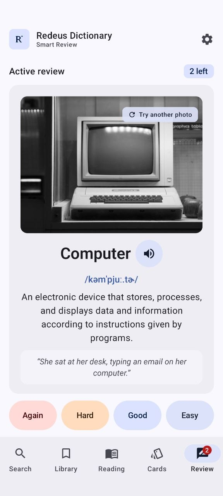
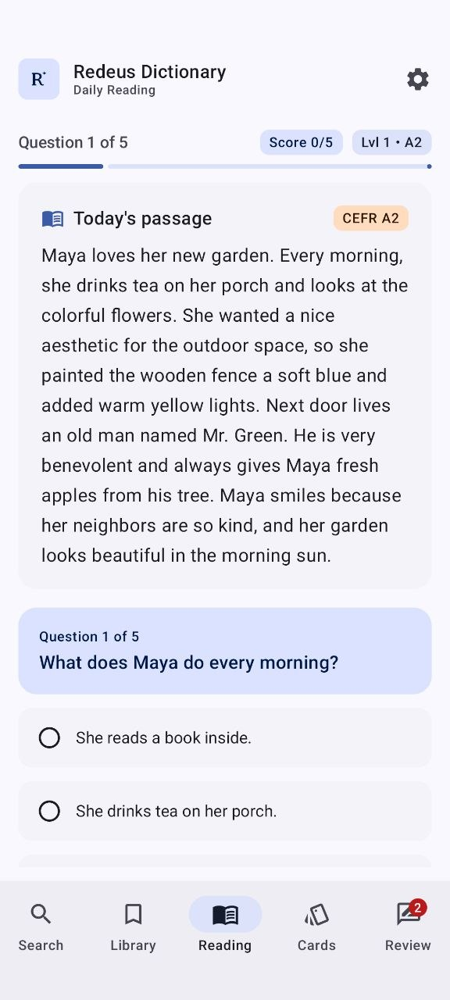
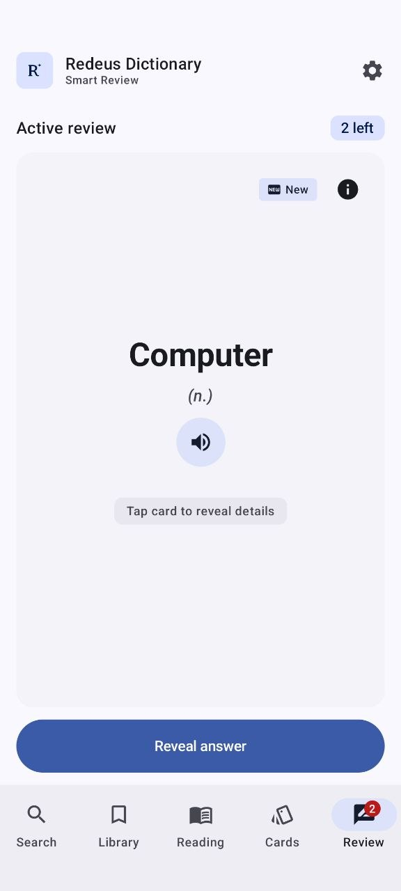
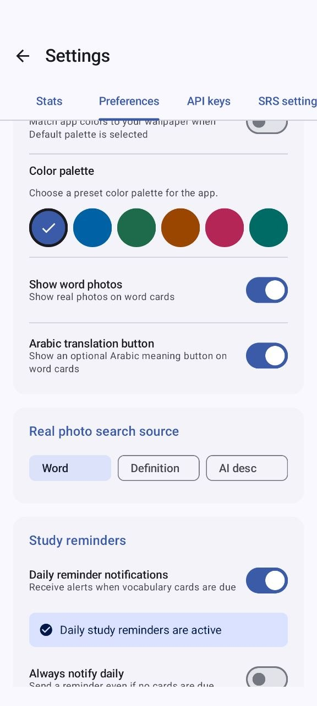
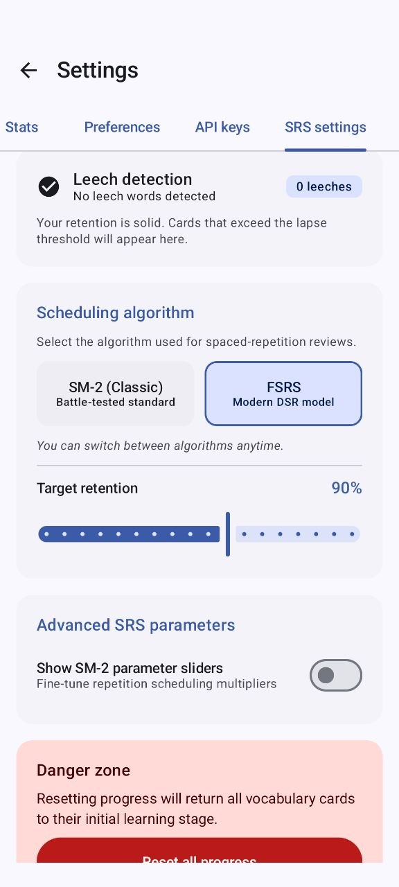
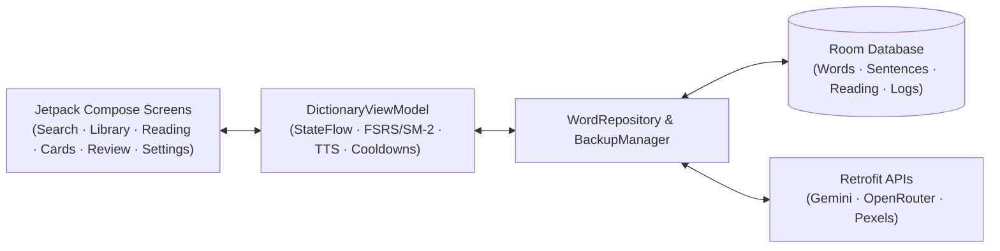

<div align="center">

<h1>📖 Redeus Dictionary</h1>

<p><strong>A smart English vocabulary-learning Android app built with Kotlin, Jetpack Compose, Material Design 3, Gemini AI, FSRS spaced repetition, and adaptive Daily Reading.</strong></p>

<p>
  <a href="https://github.com/redeus12/redeus-dictionary/actions/workflows/release-apk.yml">
    
  </a>
  <a href="https://github.com/redeus12/redeus-dictionary/releases/latest">
    
  </a>
  
  
  
</p>

<p>
  <a href="#-download--installation">📥 Download Latest APK</a> •
  <a href="#-screenshots">📸 Screenshots</a> •
  <a href="#-overview--key-features">✨ Features</a> •
  <a href="#-api-keys-bring-your-own-keys">🔑 API Keys Setup</a> •
  <a href="#-tech-stack--architecture">🏗️ Architecture</a> •
  <a href="#-local-development--building-from-source">🛠️ Build from Source</a>
</p>

<p>
  
  
  
  
</p>

</div>

---

## 📸 Screenshots

### Core Learning Flow

<table>
  <tr>
    <td align="center">
      <br />
      <sub><b>Word Lookup &amp; Definition</b></sub>
    </td>
    <td align="center">
      <br />
      <sub><b>Pexels Photo &amp; Memory Aid</b></sub>
    </td>
    <td align="center">
      <br />
      <sub><b>Library &amp; Personal Deck</b></sub>
    </td>
    <td align="center">
      <br />
      <sub><b>Daily Reading (CEFR)</b></sub>
    </td>
  </tr>
</table>

### Practice & Smart Spaced-Repetition Review

<table>
  <tr>
    <td align="center">
      <br />
      <sub><b>Smart Review (Front)</b></sub>
    </td>
    <td align="center">
      <br />
      <sub><b>Smart Review (Answer &amp; SRS)</b></sub>
    </td>
    <td align="center">
      <br />
      <sub><b>Flashcards Practice</b></sub>
    </td>
    <td align="center">
      <br />
      <sub><b>Multiple-Choice Quiz</b></sub>
    </td>
  </tr>
</table>

### Spelling, Analytics & Settings

<table>
  <tr>
    <td align="center">
      <br />
      <sub><b>Dictation &amp; Spelling</b></sub>
    </td>
    <td align="center">
      <br />
      <sub><b>Preferences &amp; Themes</b></sub>
    </td>
    <td align="center">
      <br />
      <sub><b>Detailed SRS Statistics</b></sub>
    </td>
    <td align="center">
      <br />
      <sub><b>FSRS &amp; SM-2 Settings</b></sub>
    </td>
  </tr>
</table>

---

## ✨ Overview & Key Features

### 1. 🔍 AI Word Lookup & Real Photography
- **Rich AI Definitions**: Powered by Google Gemini (default `gemini-3.5-flash-lite`, customizable in Settings) returning clear learner-friendly definitions, IPA phonetics, part of speech, synonyms/antonyms, natural usage examples, and clever memory aids (mnemonics).
- **Real Photos via Pexels**: Fetches real-world photography for each word with one-tap **"Try another photo"** pagination and configurable query source (`Word`, `Definition`, or `AI desc`).
- **Optional Arabic Meaning**: Enable an optional on-card **"Show Arabic meaning"** button (cached locally) for bilingual learners.
- **Quick Lookup from Any App**: Highlight any English word in Chrome, PDFs, or messaging apps and select **Redeus Dictionary** (`ACTION_PROCESS_TEXT` / `ACTION_SEND`) to define it instantly.

### 2. 🔊 Pronunciation (Gemini TTS + Device TTS)
- **AI & Offline Voice**: Natural speech via Gemini TTS with automatic failover across multiple API keys and seamless fallback to Android's built-in TTS.
- **Audio Controls**: Auto-pronounce toggle, `Normal` / `Slow` playback speed, and configurable **Request cooldown** sliders for both Word AI and TTS APIs to prevent HTTP 429 rate limits.

### 3. 🧠 Spaced-Repetition Review (FSRS & SM-2)
- **FSRS by Default**: Uses the modern **FSRS** scheduling model out of the box with adjustable target retention (`80%–97%`), plus one-tap switching to classic **SM-2** with optional advanced parameter sliders.
- **Leech Detection & Habit Tracking**: Automatically flags hard-to-remember words (`isLeech`), tracks daily review streaks, and includes an expandable 60-day activity heatmap.

### 4. 🃏 Flashcards, Quiz & Dictation Spelling
- **Three Practice Modes**: Flip flashcards with real photos, multiple-choice definition quizzes, and audio dictation/spelling drills with letter hints.

### 5. 📚 Adaptive Daily Reading & Grammar Check
- **CEFR-Calibrated Passages**: Generates daily reading passages tailored to your CEFR level (`A1–C1`) weaving in words from your personal vocabulary deck.
- **Comprehension & Grammar Check**: Separate reading comprehension questions and grammar check exercises with automatic level progression and history charts.

### 6. 🎨 Material Design 3, Backup & Reliability
- **Adaptive M3 UI**: Responsive layouts for phones and tablets (`NavigationBar` / `NavigationRail` + two-pane list-detail), Light/Dark/System theme modes, 6 preset color palettes, and Android 12+ Material You dynamic color.
- **Gemini-First + OpenRouter Fallback**: Automatic failover to OpenRouter when Gemini hits quota or is manually locked for the day, plus live daily AI usage tracking and a built-in **Test key** button.
- **Backup & Export**: Export/restore your entire vocabulary deck, sentences, reading sessions, and SRS progress as **JSON**, or export flashcards to **Anki CSV** via `BackupManager`.
- **Daily Study Reminders**: Customizable daily reminder notifications with a Material 3 time picker (`ReminderHelper`).

---

## 📥 Download & Installation

1. Go to the [**Latest Release**](https://github.com/redeus12/redeus-dictionary/releases/latest) page.
2. Download the `.apk` file (`RedeusDictionary-v*.apk`).
3. Open the downloaded APK on your Android 7.0+ device (allow installation from unknown sources if prompted).
4. Launch **Redeus Dictionary**, open **Settings → API keys**, and add your free Gemini API key to get started.

---

## 🔑 API Keys (Bring Your Own Keys)

Redeus Dictionary is **bring-your-own-keys** — **no real API keys are stored in this repository** (`.env.example` contains placeholder values only for Gradle's Secrets plugin).

Open **Settings → API keys** inside the app to configure your keys:

| Service | Purpose | Where to get a key |
| --- | --- | --- |
| **Google Gemini** | Unified key for word definitions, Daily Reading, and AI TTS pronunciation (supports multiple failover keys & optional separate TTS keys) | [Google AI Studio (Free)](https://aistudio.google.com/app/apikey) |
| **OpenRouter** *(optional)* | Automatic fallback provider when Gemini hits rate limits or is manually locked | [OpenRouter Keys (Free tier)](https://openrouter.ai/keys) |
| **Pexels** *(optional)* | Real-world photography for vocabulary cards | [Pexels API (Free)](https://www.pexels.com/api/) |

---

## 🏗️ Tech Stack & Architecture

| Layer | Technology | Purpose |
| --- | --- | --- |
| **Language** | Kotlin `2.2.10` | Primary application language |
| **UI** | Jetpack Compose + Material Design 3 | Adaptive UI (`material3-window-size-class`), edge-to-edge, dynamic color |
| **Images** | Coil Compose `2.7.0` | Async Pexels photo loading & caching |
| **Local Storage** | Room `2.7.0` (KSP) | `WordEntity`, `MinedSentenceEntity`, `ReadingSessionEntity`, `ReviewLogEntity` with explicit migrations |
| **Networking** | Retrofit `2.12.0`, OkHttp, Moshi | Gemini, OpenRouter, Pexels & Dictionary Audio APIs |
| **Concurrency** | Kotlin Coroutines & `StateFlow` | Unidirectional reactive UI state in `DictionaryViewModel` |
| **Testing** | JUnit, Robolectric, Roborazzi | Unit tests, persistence/SRS tests & screenshot verification |

### Architecture Diagram



### Project Structure

```text
app/src/main/java/com/example/
├── MainActivity.kt                  # Edge-to-edge host, adaptive shell, PROCESS_TEXT/SEND lookup
├── api/                             # Retrofit services (Gemini, OpenRouter, Pexels, DictionaryAudio)
├── data/                            # Room AppDatabase, Entities, DAOs, WordRepository, BackupManager
├── reminder/                        # Daily study reminder scheduling & ReminderReceiver
└── ui/
    ├── DictionaryViewModel.kt       # App state, FSRS/SM-2 engine, TTS failover, reading, preferences
    ├── components/                  # Shared M3 badges, dialogs, streak/heatmap banner
    ├── navigation/                  # Adaptive NavigationBar / NavigationRail shell
    ├── screens/
    │   ├── search/                  # Word lookup & WordDetailsCard
    │   ├── library/                 # Personal Deck & History (list-detail on expanded widths)
    │   ├── reading/                 # Daily Reading & Grammar Check
    │   ├── practice/                # Flashcards, Quiz & Spelling
    │   ├── review/                  # Smart SRS Review
    │   └── settings/                # Stats, Preferences, API keys & SRS settings
    └── theme/                       # Material 3 Color, Type, Shape, Motion & Dynamic Color theme
```

---

## 🛠️ Local Development & Building from Source

### Prerequisites
- **Android Studio** (Ladybug or newer)
- **JDK 17+** (JDK 21 recommended)
- **Android SDK**: `minSdk 24`, `targetSdk 36`, `compileSdk 36.1`

### 1. Clone the Repository
```bash
git clone https://github.com/redeus12/redeus-dictionary.git
cd redeus-dictionary
```

### 2. Build the Debug APK via CLI
```bash
./gradlew assembleDebug
```
On Windows PowerShell:
```powershell
.\gradlew.bat assembleDebug
```

### 3. Run Unit Tests
```bash
./gradlew testDebugUnitTest
```

---

## 📄 License

This project is licensed under the [MIT License](LICENSE).
