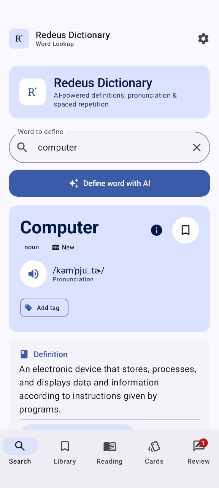
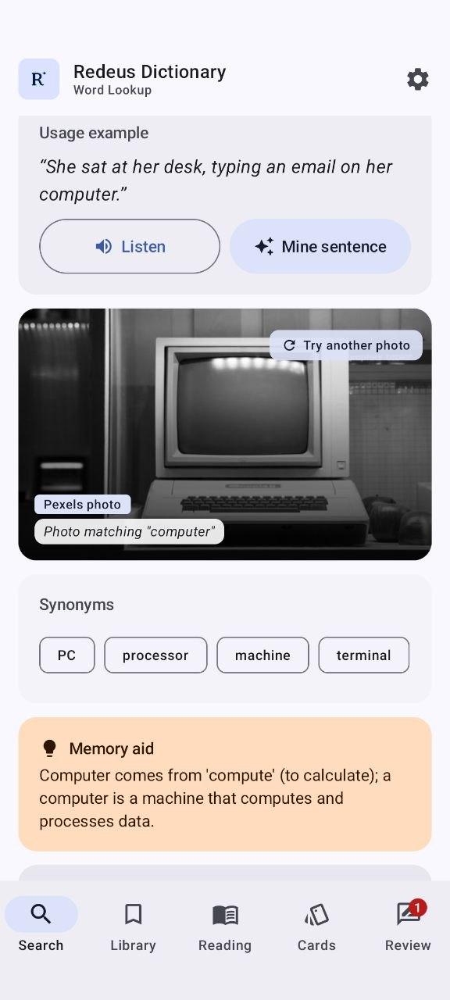
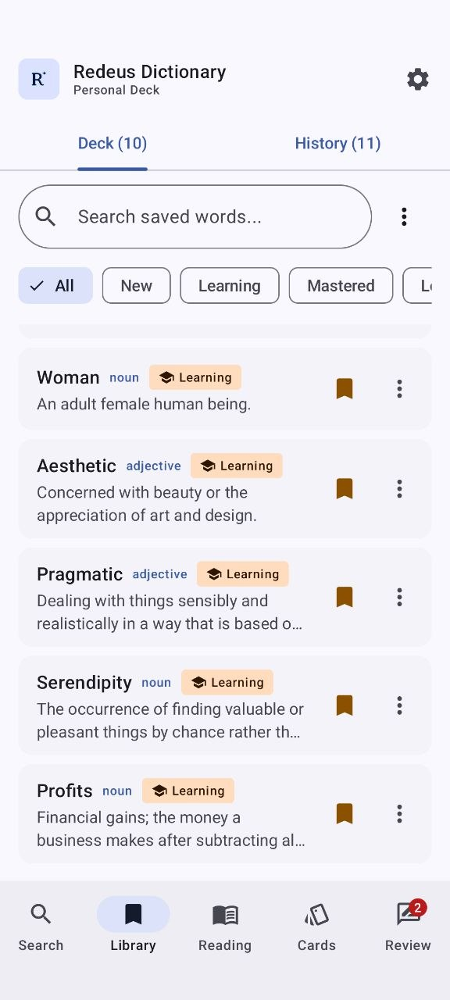
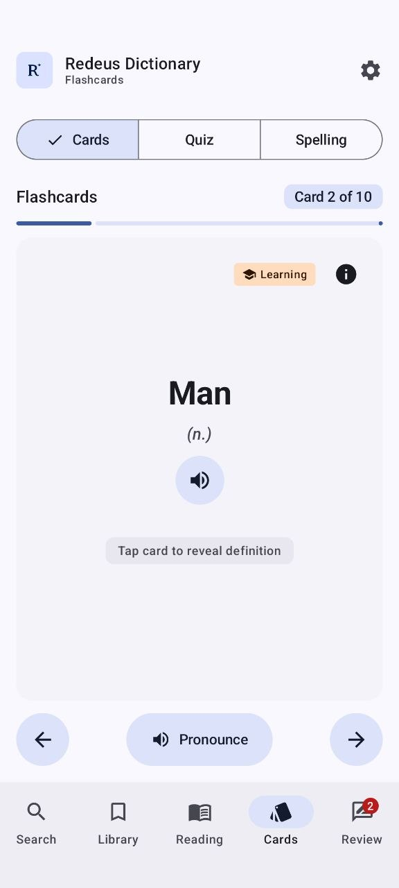
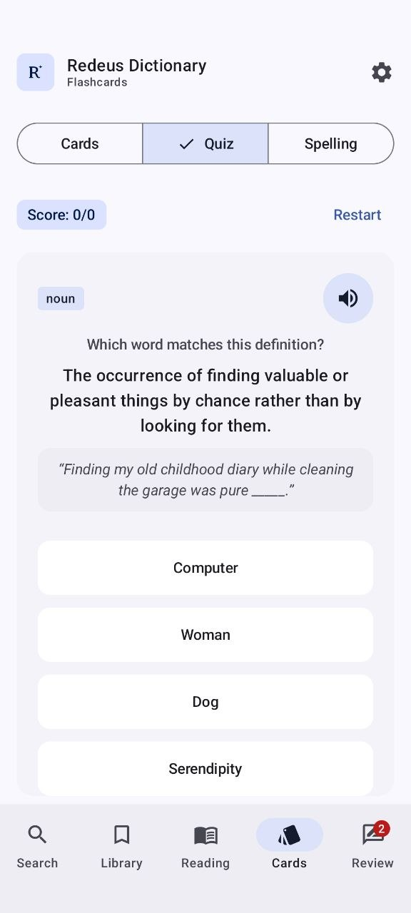
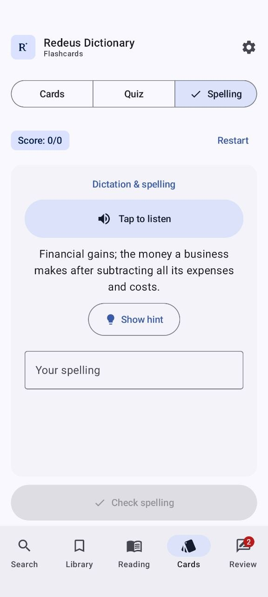
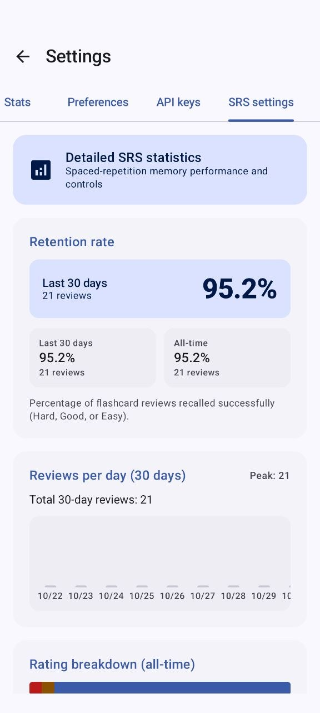

# Redeus Dictionary

A smart English vocabulary-learning Android app built with Kotlin, Jetpack Compose, Material Design 3, and Room — combining AI-powered word lookup, real photography, pronunciation, spaced-repetition reviews, and adaptive daily reading.

## Features

- **AI Word Lookup**: Instant definitions, IPA phonetics, parts of speech, synonyms/antonyms, usage examples, memory aids (mnemonics), and optional Arabic translation powered by Google Gemini.
- **Real Photos (Pexels)**: Real-world photography for each word from Pexels with one-tap **"Try another photo"** cycling and configurable search query source (`Word`, `Definition`, or `AI desc`).
- **Pronunciation (Gemini TTS + Device TTS)**: Natural AI pronunciation via Gemini TTS with automatic failover across multiple API keys and seamless fallback to built-in Android TTS, plus configurable speech speed and request cooldowns.
- **Flashcards, Quiz & Spelling**: Practice bookmarked words with interactive flip flashcards, multiple-choice quizzes, and audio dictation/spelling drills.
- **Spaced-Repetition Review (FSRS & SM-2)**: Smart daily review queue defaulting to the modern **FSRS** algorithm (with customizable target retention) and optional switch to classic **SM-2**, plus leech detection and 60-day habit tracking.
- **Daily Reading**: Personalized daily passages at your adaptive **CEFR** level (A1–C1) incorporating your vocabulary, complete with comprehension questions and a separate **Grammar Check**.
- **Reading Progress & AI Usage Stats**: Detailed retention rate, 30-day review charts, deck composition, reading history, and daily Gemini / OpenRouter request counters.
- **Bookmarks, Tags & Quick Lookup**: Organize saved vocabulary with custom tags, filter by learning status, export/restore JSON backups or Anki CSV decks, and look up highlighted words from any app via Android text selection (`PROCESS_TEXT` / Share).
- **Gemini-First with OpenRouter Fallback**: Automatic failover to OpenRouter when Gemini hits rate limits or is manually locked for the day.
- **Study Reminders & Theming**: Customizable daily reminder notifications with time picker, Material Design 3 light/dark/system modes, preset color palettes, and Android 12+ Material You dynamic color.

## Screenshots

<table>
  <tr>
    <td align="center">
      <br />
      <sub><b>Word Lookup &amp; Definition</b></sub>
    </td>
    <td align="center">
      <br />
      <sub><b>Pexels Photo, Synonyms &amp; Memory Aid</b></sub>
    </td>
    <td align="center">
      <br />
      <sub><b>Library &amp; Personal Deck</b></sub>
    </td>
  </tr>
  <tr>
    <td align="center">
      <br />
      <sub><b>Smart Review (Front)</b></sub>
    </td>
    <td align="center">
      <br />
      <sub><b>Smart Review (Answer &amp; SRS Rating)</b></sub>
    </td>
    <td align="center">
      <br />
      <sub><b>Flashcards Practice</b></sub>
    </td>
  </tr>
  <tr>
    <td align="center">
      <br />
      <sub><b>Multiple-Choice Quiz</b></sub>
    </td>
    <td align="center">
      <br />
      <sub><b>Dictation &amp; Spelling</b></sub>
    </td>
    <td align="center">
      <br />
      <sub><b>Daily Reading (Adaptive CEFR)</b></sub>
    </td>
  </tr>
  <tr>
    <td align="center">
      <br />
      <sub><b>Preferences, Themes &amp; Reminders</b></sub>
    </td>
    <td align="center">
      <br />
      <sub><b>Detailed SRS Statistics</b></sub>
    </td>
    <td align="center">
      <br />
      <sub><b>FSRS &amp; SM-2 Scheduling Settings</b></sub>
    </td>
  </tr>
</table>

## Setup

### Requirements

- **Android Studio** (Ladybug or newer recommended)
- **JDK 17+**
- **Android SDK**: `minSdk 24` (Android 7.0), `targetSdk 36`, `compileSdk 36.1`

### Build & Run

1. Clone the repository and open it in Android Studio, or build from the command line:
   ```bash
   ./gradlew assembleDebug
   ```
   On Windows:
   ```powershell
   .\gradlew.bat assembleDebug
   ```
2. Install on a connected device or emulator:
   ```bash
   ./gradlew installDebug
   ```

### API Keys (Bring Your Own Keys)

Redeus Dictionary is **bring-your-own-keys** — no real API keys are stored in this repository (`.env.example` contains placeholder values only for Gradle's Secrets plugin).

After launching the app, open **Settings → API keys** to enter your keys:

| Service | Purpose | Where to get a key |
| --- | --- | --- |
| **Google Gemini** | Word definitions, Daily Reading, and AI TTS pronunciation (supports multiple keys & optional separate TTS keys) | [Google AI Studio](https://aistudio.google.com/app/apikey) |
| **OpenRouter** *(optional)* | Automatic fallback provider when Gemini hits rate limits or is locked | [OpenRouter Keys](https://openrouter.ai/keys) |
| **Pexels** *(optional)* | Real photos for vocabulary words | [Pexels API](https://www.pexels.com/api/) |

## Tech Stack

- **Language**: Kotlin
- **UI**: Jetpack Compose, Material Design 3 (`material3`, `material3-window-size-class`), Coil
- **Local Persistence**: Room (SQLite + KSP) with explicit schema migrations
- **Networking**: Retrofit, OkHttp, Moshi
- **Concurrency**: Kotlin Coroutines & `StateFlow`
- **Testing**: JUnit, Robolectric, Roborazzi

## Project Structure

```text
app/src/main/java/com/example/
├── MainActivity.kt                  # Edge-to-edge host, adaptive shell, PROCESS_TEXT/SEND lookup
├── api/                             # Retrofit services (Gemini, OpenRouter, Pexels, DictionaryAudio)
├── data/                            # Room database, entities, DAOs, WordRepository, BackupManager
├── reminder/                        # Daily study reminder scheduling & BroadcastReceiver
└── ui/
    ├── DictionaryViewModel.kt       # App state, SRS (FSRS/SM-2), TTS, reading, preferences
    ├── components/                  # Shared M3 badges, dialogs, streak/heatmap banner
    ├── navigation/                  # Adaptive NavigationBar / NavigationRail shell
    ├── screens/
    │   ├── search/                  # Word lookup & WordDetailsCard
    │   ├── library/                 # Personal Deck & History (list-detail on expanded widths)
    │   ├── reading/                 # Daily Reading & Grammar Check
    │   ├── practice/                # Flashcards, Quiz & Spelling
    │   ├── review/                  # Smart SRS Review
    │   └── settings/                # Stats, Preferences, API keys & SRS settings
    └── theme/                       # Material 3 Color, Type, Shape, Motion & Dynamic Color theme
```

## License

This project is licensed under the [MIT License](LICENSE).
